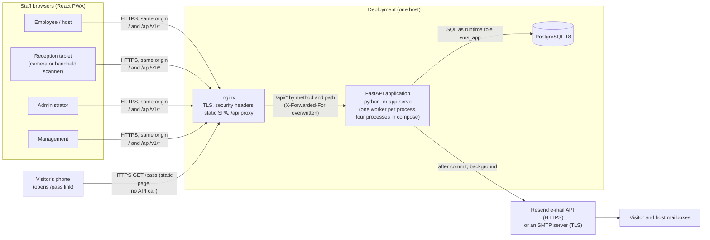
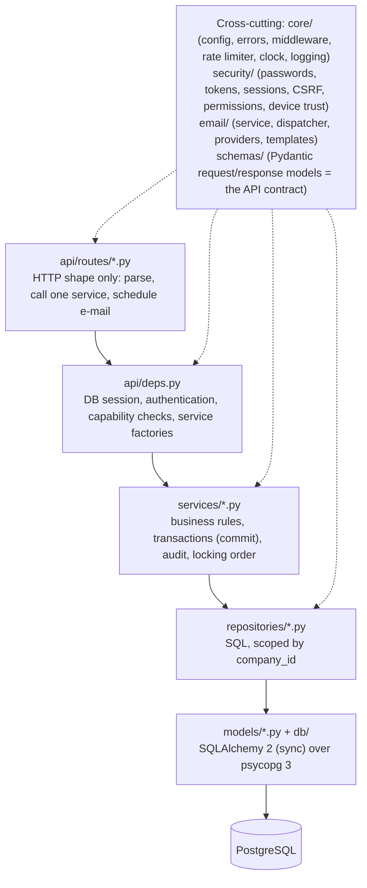
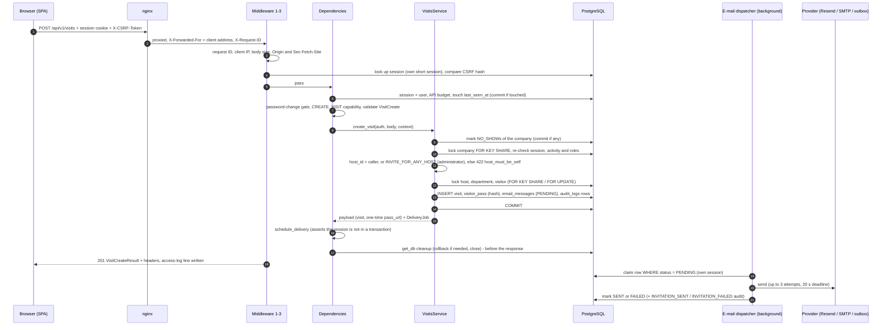
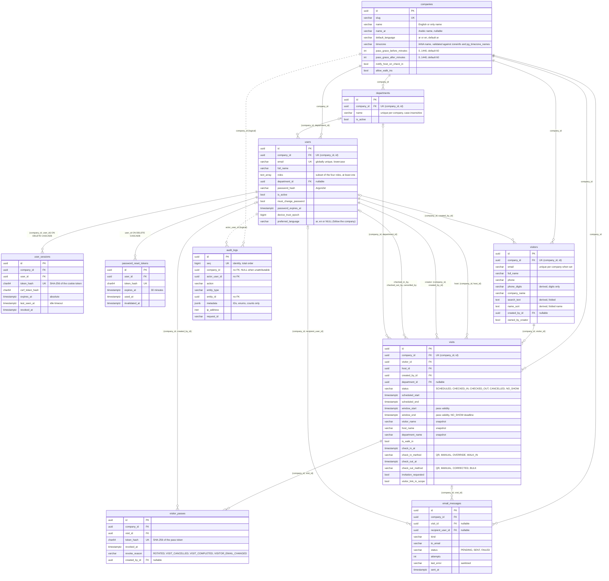
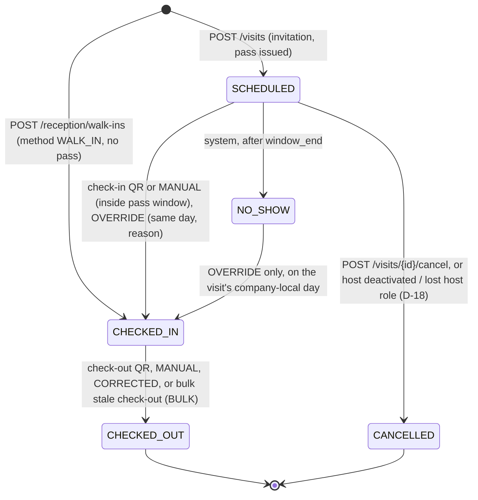
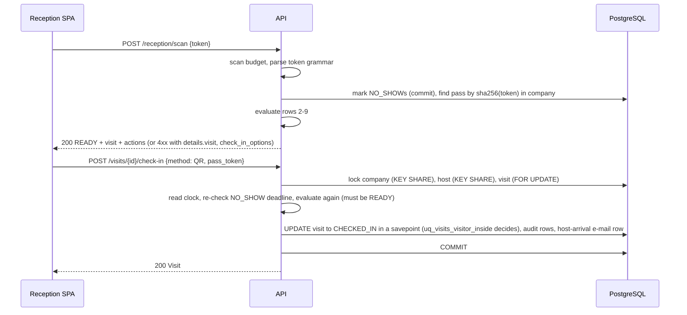
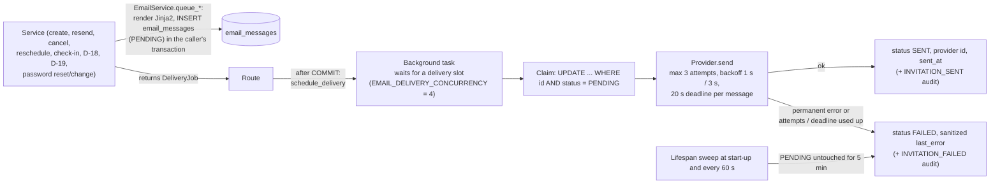
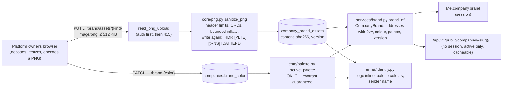
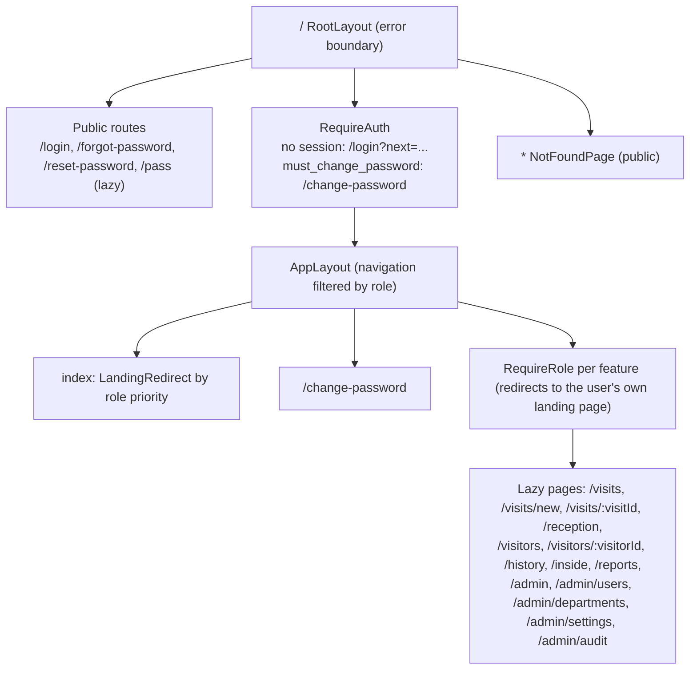
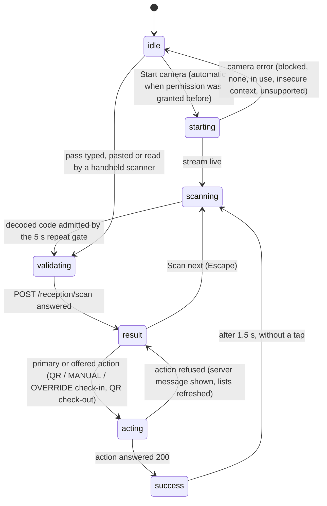

# Architecture

This document describes how Mawdoo3 Visitors («زوار موضوع») is built: its parts, how a request travels
through them, the data model, the visit and pass rules, e-mail delivery, tenant isolation, concurrency,
the bilingual frontend, and where the planned extensions would attach. It is written for the customer's
IT and security teams and for the engineers who run and extend the system. Internal identifiers keep the
project's short name `vms` (database, roles, cookies, `VMS_*` settings); nobody reads them as a name.

| | |
|---|---|
| Describes | API version `1.0.0`, database schema revision `0015` (Alembic head), frontend in `frontend/` (Arabic and English) |
| Binding contract | [`docs/initial-assessment.md`](initial-assessment.md) (revision 5) |
| Deviations from the contract | [`docs/decisions/`](decisions/) (one file per phase and area; IDs such as `B24-73` or `SEC-07` below refer to entries there) |
| Security controls | [`docs/security.md`](security.md) (controls as implemented); findings and residual risks in [`docs/security-audit.md`](security-audit.md) |
| Deployment runbook | [`deploy/README.md`](../deploy/README.md) |
| API reference | [`docs/api.md`](api.md) |

Where this document and the contract differ, the code and the decision files are authoritative; the
differences are listed in [§14](#14-differences-from-the-contract-text).

---

## Contents

1. [System context](#1-system-context)
2. [Modular monolith: layers and packages](#2-modular-monolith-layers-and-packages)
3. [Request lifecycle](#3-request-lifecycle)
4. [Data model](#4-data-model)
5. [Visit state machine](#5-visit-state-machine)
6. [Visitor pass (QR) design](#6-visitor-pass-qr-design)
7. [E-mail pipeline](#7-e-mail-pipeline)
8. [Multi-tenancy model](#8-multi-tenancy-model)
9. [Concurrency and locking](#9-concurrency-and-locking)
10. [Security building blocks](#10-security-building-blocks)
11. [Frontend architecture](#11-frontend-architecture)
12. [Extensibility points for planned features](#12-extensibility-points-for-planned-features)
13. [Operational characteristics and limits](#13-operational-characteristics-and-limits)
14. [Differences from the contract text](#14-differences-from-the-contract-text)
15. [How this document was verified](#15-how-this-document-was-verified)

---

## 1. System context

| Actor / system | Role |
|---|---|
| Employee (EMPLOYEE) | Invites visitors, manages own visits, shares the pass link when e-mail fails. |
| Reception (RECEPTIONIST) | Scans passes, checks visitors in and out, registers walk-ins, keeps the evacuation list. |
| Administrator (SYSTEM_ADMIN) | Manages users, departments and company settings; reads the audit log; can do everything reception and employees can. |
| Management (MANAGEMENT) | Read-only: reports, company-wide history, evacuation list. |
| Visitor | Receives a bilingual invitation e-mail (Arabic and English) with a QR code; opens the static `/pass` page. Visitors never sign in. |
| nginx | Serves the built SPA, terminates TLS, adds the browser security headers, proxies `/api/` to the API and shares the API requests out over the API services by method and path (§13). Configuration in `deploy/nginx/`. |
| API | The only component with business logic. Started only through `python -m app.serve` (`backend/app/serve.py`), which fixes the server options (one worker per process, no uvicorn proxy-header handling, no `Server` header, no uvicorn access log, no WebSocket protocol, 20 s graceful shutdown). In production the same image runs as four processes (§13). |
| PostgreSQL | Single source of truth. The API connects as the restricted runtime role; migrations run as the schema owner. |
| E-mail provider | Resend (`EMAIL_PROVIDER=resend`, recommended for production with a verified domain) or any SMTP server over TLS (`EMAIL_PROVIDER=smtp`, for example Gmail with an App Password on port 465). Development and the E2E suite use the file-based `outbox` provider. |

**Same origin, no CORS.** The SPA calls `/api/v1/*` on its own origin: through the Vite proxy in
development (`frontend/vite.config.ts`, `xfwd: true`) and through nginx in production. Neither the API
nor the dev server enables CORS (`cors: false` in Vite, no `CORSMiddleware` in FastAPI).

**Topologies.**

| | Development (this repository, verified) | Production (docker compose, see `deploy/README.md`) |
|---|---|---|
| Browser entry | Vite dev server `:5173` (or `npm run dev:https` for LAN tablets) | nginx `:443` (HTTP `:80` redirects) |
| API | `python -m app.serve` on `127.0.0.1:8000` | containers `backend`, `backend-reception` (two replicas) and `backend-reports`, each on port 8000 and reachable only from nginx |
| Database | portable PostgreSQL 18.6 on `localhost:5433` (`scripts/db.ps1`) | `postgres` container on an internal network |
| E-mail | `outbox` provider (files in `backend/var/outbox`) | `resend` or `smtp` provider (outbox, memory and SMTP without TLS are refused in production) |
| Status | Run and tested on Windows 11 | **Not verified on this machine (no Docker).** The nginx configuration, provisioning scripts and production-mode API were exercised without containers; see `docs/decisions/phase-9-deploy.md` "NOT VERIFIED". |

---

## 2. Modular monolith: layers and packages

The backend is one deployable FastAPI application with internal layering. Requests flow down through
the layers below; services work with the model objects that repositories return and own the
transaction. Cross-cutting packages are used by all layers.

| Package (`backend/app/`) | Responsibility |
|---|---|
| `main.py` | Composition root `create_app()`: builds the engine, the one `ServiceEnvironment` (rate limiter, policies, e-mail renderer), the e-mail dispatcher, the D-17/D-18 hooks; registers exception handlers, middleware and routers; runs the lifespan tasks. |
| `serve.py` | The only supported run command (fixed uvicorn options). |
| `cli.py` | Operator commands: `seed-demo` (the demo company in Arabic), `seed-e2e` (the same company in English plus "Other Corp"; both refused in production), `create-admin`, `mark-no-shows`, `prune-sessions`, `e2e-time-travel` (refused in production), `send-test-email [--language ar\|en]` (one message through the configured provider; no database). Work happens in services. |
| `contract.py` | Generates the contract snapshot `frontend/src/types/backend-contract.json` from the Pydantic schemas; a backend test fails when it is stale and a frontend test compares it with `frontend/src/types/api.ts`. |
| `api/routes/` | One module per resource (`health`, `auth`, `users`, `departments`, `company`, `visitors`, `visits`, `reception`, `dashboard`, `reports`, `audit_logs`). Routes are thin: they name one capability, call one service method and schedule e-mail deliveries after the service committed. |
| `api/deps.py` | `DbSession` (`Depends(get_db, scope="function")`), `SessionAuth`, `CurrentAuth` (password-change gate), `require_capability(...)`, and one factory per service. |
| `api/cookies.py` | Session, CSRF and device cookies. |
| `services/` | All business rules. Notable modules: `visits.py`, `visit_lifecycle.py` (shared visit changes), `visit_rules.py` (pure state machine, scheduling and permission rules), `attendance.py` (check-in/out, bulk, walk-ins), `scan.py` (pure §6 evaluation), `passes.py`, `visitors.py`, `users.py`, `auth.py`, `authorization.py` (re-check after lock), `preferences.py` (the caller's language), `no_shows.py`, `email_quota.py`, `audit.py` (writers, coalescer), `visit_hooks.py` (D-17 snapshots, D-18 cancellations), `seeding.py` (the demo and E2E seeds). |
| `repositories/` | Data access. Every method takes `company_id` (a unit test enforces this outside a documented allow-list). `locking.py` defines the lock modes and the global lock order; `scope.py` the §7.5 read-scope predicates; `pagination.py` the page/total helper. |
| `models/` | One module per aggregate; `enums.py` holds the stored enum values. |
| `schemas/` | Pydantic request, query and response models. Request models forbid unknown fields; query models are one class per endpoint. |
| `core/` | `config.py` (settings, production refusals), `errors.py` (error classes and envelope), `field_errors.py` (the 422 field codes, B10-18), `middleware.py`, `rate_limit.py`, `time.py` (application clock, company-local day bounds), `client_ip.py`, `routing.py` (route templates for logs and audit), `search.py` (text folding), `qr.py`, `logging.py`. |
| `security/` | `passwords.py` (Argon2id, policy), `tokens.py` (opaque tokens, pass-URL grammar), `sessions.py`, `csrf.py`, `permissions.py` (capability matrix), `device_trust.py`, `secret_strength.py`. |
| `email/` | `service.py` (queue messages, choose the leading language), `dispatcher.py` (deliver after commit), `providers/` (`resend`, `smtp`, `outbox`, `memory`), `rendering.py` + `templates/` (Jinja2, autoescape for HTML), `i18n.py` (the Arabic and English catalog of every e-mail), `bidi.py` (direction isolation of values), `formatting.py` (dates and times per language), `assets/brand-logo.png` (the inline logo). |
| `db/` | `session.py` (engine options, the single `session_factory`, `get_db`), `base.py` (declarative base, naming convention), `privileges.py` (production start-up check of the runtime role). |

**Rules that hold everywhere** (contract §3.2, enforced by code or tests):

- **Unit of work.** `get_db` never commits; services call `db.commit()` explicitly. See [§3.3](#33-unit-of-work-and-background-work).
- **One session factory.** Requests, the e-mail dispatcher, the security-event writer and the CLI all obtain sessions from `app.db.session.session_factory`.
- **One clock.** Business time comes from `app.core.time.now()` (aware UTC), never from SQL `now()`; tests replace it with a fake clock.
- **Authorization by capability.** Routes name a capability from `security/permissions.py`; row-level rules (ownership, employee scope) are applied in services. See [`docs/api.md` §6](api.md#6-roles-and-capabilities).
- **Tenant scoping.** `company_id` comes only from the session; see [§8](#8-multi-tenancy-model).
- **No personal data in logs or audit metadata.** Audit metadata accepts only identifier-shaped strings (`services/audit.py::sanitize_metadata`); the access log never contains query strings.

---

## 3. Request lifecycle

### 3.1 Middleware and dependency order

Middleware is pure ASGI (`backend/app/core/middleware.py`). Starlette wraps middleware in reverse order
of addition; the effective order, outermost first, is:

| # | Component | What it does | Answers itself with |
|---|---|---|---|
| 1 | `RequestContextMiddleware` | Request ID (adopts `X-Request-ID` only from a `TRUSTED_PROXIES` peer, otherwise generates one); client IP (rightmost untrusted `X-Forwarded-For` entry when the peer is a trusted proxy, else the peer; invalid → none); adds response headers (`X-Request-ID`, `X-Content-Type-Options`, `Referrer-Policy`, `X-Frame-Options`, `Cross-Origin-Opener-Policy`; on `/api/v1`: `Cache-Control: no-store`, a `default-src 'none'` CSP, `Cross-Origin-Resource-Policy`, `Permissions-Policy`; HSTS when `APP_ENV=production`); writes one JSON access-log line (method, path without query string, route template, status, duration, client IP, user and company IDs); turns any unhandled exception into a 500 envelope. | 500 `INTERNAL_ERROR` |
| 2 | `BodySizeLimitMiddleware` | For `/api/v1` paths: refuses a declared `Content-Length` above `MAX_REQUEST_BODY_BYTES` (default 65,536) without reading it, and counts streamed bytes otherwise. One route has a limit of its own (`BodyLimit`, matched on the method and the route path): the upload of a company's brand image, 524,288 bytes (Phase 12, B12-6). | 413 `PAYLOAD_TOO_LARGE` |
| 3 | `CsrfOriginMiddleware` | For unsafe methods (`POST`, `PUT`, `PATCH`, `DELETE`) under `/api/v1`: (a) rejects `Sec-Fetch-Site: cross-site`, and `same-site` without an allowed `Origin`; (b) a present `Origin` must be in `ALLOWED_ORIGINS`; (c) a request that carries a live session cookie must send `X-CSRF-Token` matching that session (constant-time hash compare). Check (c) is skipped only for `POST /auth/login`, `/auth/forgot-password`, `/auth/reset-password`. Failures are audited (`CSRF_FAILED`, coalesced). The session lookup uses its own short database session. | 403 `CSRF_FAILED`; 503 `SERVICE_BUSY` if the session lookup cannot reach the database |
| 4 | FastAPI router + exception handlers | `redirect_slashes=False` (no 307 to a Host-derived URL). Handlers map every error to the envelope (see [`docs/api.md` §4](api.md#4-errors)). | 404/405/422/… |
| 5 | Dependencies | `get_db` (request session, `scope="function"`); `get_session_auth` (cookie → live session and active user, then the per-user API budget, then `last_seen_at` refresh at most once a minute and never for `X-Background-Refresh: 1`); `get_current_auth` (403 `PASSWORD_CHANGE_REQUIRED` unless the route uses `SessionAuth`); `require_capability(...)`. | 401, 403, 429 |
| 6 | Request validation | Path IDs, query model, body model. Authentication and authorization dependencies run before body validation, so an unauthenticated or unauthorized caller gets 401/403, never a 422 that reveals the body schema (verified: an anonymous `POST /departments` with `{}` answers 401, an employee's answers 403). A malformed path ID answers 404, not 422. | 404, 422 |
| 7 | Route → service | The service does the work and commits. The route then schedules e-mail deliveries. | business errors |

### 3.2 A mutating request end to end

The sequence for `POST /api/v1/visits` with `send_invitation: true`:

### 3.3 Unit of work and background work

- **Transactions.** A request holds one SQLAlchemy session (`expire_on_commit=False`). Services
  commit explicitly; `get_db` only rolls back an open transaction and closes the session. Read-only
  endpoints commit only when the NO_SHOW marking they run first changed something.
- **Cleanup before background tasks.** `DbSession` is declared `Depends(get_db, scope="function")`, so
  the session is closed when the endpoint returns, before the response is sent and before any
  background task runs. `tests/unit/test_dependency_ordering.py` pins this FastAPI behaviour.
- **E-mail only after commit.** `email.dispatcher.schedule_delivery` raises if the request session is
  still in a transaction (`ensure_committed`), so a delivery can never refer to uncommitted data.
- **Deliveries do not use request threads.** Sync routes and dependencies run in anyio's default
  thread pool (40 threads). A delivery is an async background task that waits for one of the
  dispatcher's own slots (`EMAIL_DELIVERY_CONCURRENCY`, default 4) and runs the provider call in a
  worker thread holding that slot, so a hanging provider delays only e-mail
  (`docs/decisions/phase-9-backend.md` RR1-02).
- **Failure and denial audit rows survive the rollback.** Successful business events are written with
  `audit.record(db, ...)` inside the business transaction. Failures and denials (`AUTH_LOGIN_FAILED`,
  `ACCESS_DENIED`, `CSRF_FAILED`, `RATE_LIMITED`, refused scans and check-ins, ...) are attached to the
  raised `AppError` and written by the exception handler through `record_security_event`, which uses
  its own session and commits immediately. `RATE_LIMITED` and `CSRF_FAILED` are coalesced per
  source and 60-second window; a user's `ACCESS_DENIED`, `VISITOR_LINK_REFUSED` and
  `USER_CHANGE_REFUSED` are capped at 10 written rows per window with a summary row for the rest
  (B1-33, B1-55, B1-59, SEC-15).

### 3.4 Lifespan tasks

`create_app()`'s lifespan (`backend/app/main.py`):

1. In production only: refuse to start unless the connected database role is the restricted runtime
   role (`db/privileges.py`, see [§10](#10-security-building-blocks)).
2. Mark FAILED every `email_messages` row left PENDING and untouched for 5 minutes (deliveries lost
   with a previous process).
3. Start two periodic tasks: flush expired coalescing windows of security events (every 60 s) and
   repeat step 2 (every 60 s).
4. On shutdown: write still-held coalesced counts (`SecurityAudit.flush`), dispose the health probe and
   the engine.

Before that, `create_app()` logs the e-mail configuration warnings (`email_configuration_warnings`,
S10-2), naming settings only: an `EMAIL_FROM` that is not the Gmail account, a port that does not match
`SMTP_SECURITY` (465 with `starttls`, or 25 or 587 with `ssl`), and, with a provider that really sends, a
`QR_BASE_URL` on this computer, whose pass links no visitor's phone can open. `send-test-email` prints the
same warnings.

### 3.5 Database connections and time limits

`db/session.py` pins session settings on every connection through libpq startup options, whatever
the server, database or role defaults are: `timezone=UTC`, `client_encoding=UTF8`, `DateStyle=ISO`,
`search_path=public`, `default_transaction_isolation=read committed`,
`default_transaction_read_only=off` and others (SEC-37, SEC-38). The application engine also sets:

| Setting | Default | Effect when exceeded |
|---|---|---|
| `DB_CONNECT_TIMEOUT_SECONDS` (libpq `connect_timeout`) | 5 s | 503 `SERVICE_BUSY` |
| `DB_POOL_TIMEOUT_SECONDS` (wait for a pooled connection) | 5 s | 503 `SERVICE_BUSY` |
| `DB_STATEMENT_TIMEOUT_MS` (`statement_timeout`) | 30,000 ms | 503 `SERVICE_BUSY` |
| `DB_LOCK_TIMEOUT_MS` (`lock_timeout`) | 10,000 ms | 503 `SERVICE_BUSY` |
| `DB_POOL_SIZE` | 10 (plus the same number of overflow connections) | — |
| TCP keepalives; `tcp_user_timeout` (Linux only) | keepalive idle 30 s, interval 10 s, 3 probes; unacknowledged data given up after 30 s | a vanished database peer is detected in about a minute instead of hours |

`GET /api/v1/health` is an async route that checks the database on a connection of its own (no pool,
2 s connect and statement timeout), answers within 3 s and caches the result for 1 s, so it answers
even while every request thread waits for the database.

---

## 4. Data model

### 4.1 Conventions

- Primary keys are UUIDs generated in Python (version 4). The seed commands use deterministic version-5
  IDs derived from slugs, names and e-mail addresses, and so does `create-admin` for a company it creates
  (its administrator gets a version-4 ID). `audit_logs` additionally has
  `seq bigint GENERATED ALWAYS AS IDENTITY` for a total order.
- All timestamps are `timestamptz`, written from the application clock in UTC (the `now()` server
  defaults are only a fallback).
- Enumerations are `varchar` with `CHECK` constraints (values in [`docs/api.md` §8](api.md#8-schemas)).
- Every table except `companies`, `password_reset_tokens` (which hangs off its user) and `audit_logs`
  (nullable, see below) carries `company_id NOT NULL`. `users`, `departments`, `visitors` and `visits`
  have `UNIQUE (company_id, id)` so that every tenant reference can be a **composite foreign key**
  `(company_id, x_id) → parent(company_id, id)`. A row can therefore never reference a row of another
  company, even through a defect in the application.
- Nothing is deleted by the application (D-12): users and departments are deactivated, visits and
  visitors are kept, sessions and reset tokens are revoked or invalidated in place, passes are revoked.
  The runtime role has no `DELETE` privilege at all (revision 0006).
- The extension `pg_trgm` provides trigram GIN indexes for search.

### 4.2 Entity-relationship diagram

All nine application tables and their keys (the migration bookkeeping table `alembic_version` is
omitted). Relationship labels name the foreign-key columns; dotted lines are logical references
without a foreign key.

All foreign keys except the two `CASCADE` ones are `ON DELETE RESTRICT`. `audit_logs` deliberately has
no foreign keys (B1-01): an audit write must never fail because of the state of the rows it
describes, and reads use outer joins.

### 4.3 Integrity rules enforced by the database

| Rule | Mechanism |
|---|---|
| A visitor can be inside only once at a time | Partial unique index `uq_visits_visitor_inside (company_id, visitor_id) WHERE status = 'CHECKED_IN'` → 409 `VISITOR_ALREADY_INSIDE` |
| At most one active pass per visit | Partial unique index `uq_passes_active_visit (visit_id) WHERE revoked_at IS NULL` |
| Visitors deduplicated by e-mail per company | `uq_visitors_company_id_email` (NULLs distinct); inserts use `ON CONFLICT DO NOTHING` |
| User e-mail globally unique (D-03) | `uq_users_email` |
| Department names unique per company | `uq_departments_company_name (company_id, lower(name))`; Arabic names: `uq_departments_company_name_ar (company_id, lower(name_ar)) WHERE name_ar IS NOT NULL` |
| No department's name or Arabic name is another department's, across the languages (B10-29) | Not an index (rows written before the rule may break it): `DepartmentsService` checks each new value against the other language's column while holding the company row `FOR UPDATE`, which every change that names a department takes → 409 `CONFLICT` |
| Visit fields consistent with status | Two-way `CHECK`s, e.g. `(status IN ('CHECKED_IN','CHECKED_OUT')) = (check_in_at IS NOT NULL)`, `(status = 'CANCELLED') = (cancelled_at IS NOT NULL)`, `check_out_at >= check_in_at`, `scheduled_end > scheduled_start`, `window_start <= scheduled_start AND window_end >= scheduled_end`, OVERRIDE requires a note, CORRECTED/BULK require a note, `is_walk_in = (check_in_method = 'WALK_IN')` |
| Checked-out and cancelled visits are immutable | Row trigger `visits_terminal_immutable`: `BEFORE UPDATE ... WHEN OLD.status IN ('CHECKED_OUT','CANCELLED')` raises |
| Audit log is append-only | Statement trigger `audit_logs_immutable`: `BEFORE UPDATE OR DELETE OR TRUNCATE` raises; the runtime role has only `SELECT` and column-level `INSERT` (every column except `seq`) |
| Lowercase / non-blank text | `CHECK`s on e-mail columns, `slug`, `email_domain`, names and `purpose` |
| Reset token has one outcome | `CHECK (used_at IS NULL OR invalidated_at IS NULL)` |

**Runtime-role privileges** (verified on a freshly migrated database): `SELECT, INSERT, UPDATE` on the
eight other application tables; on `audit_logs` `SELECT` and `INSERT` on all columns except `seq`; no
`DELETE`, `TRUNCATE`, `REFERENCES`, `TRIGGER`, DDL or `TEMPORARY`; nothing on `alembic_version`. Default
privileges give later tables the same `SELECT, INSERT, UPDATE`.

### 4.4 Indexes that matter for performance

| Index | Serves |
|---|---|
| `ix_visitors_search_text_trgm`, `ix_visitors_phone_digits_trgm` (GIN trigram) | visitor search (`GET /visitors?q=`), stored-visitor part of history search |
| `ix_visits_visitor_name_trgm`, `ix_visits_visitor_company_name_trgm`, `ix_visits_host_name_trgm` | history search on visit snapshots (`GET /visits?q=`, revision 0007) |
| `ix_visitors_company_id_name_sort_id` | visitor list order |
| `ix_visits_company_id_scheduled_start_id` (+ partial `..._scheduled` for `status = 'SCHEDULED'`) | visit lists, reception "expected" |
| `ix_visits_company_id_window_end_scheduled` (partial) | NO_SHOW marking |
| `ix_visits_company_id_check_in_at`, `ix_visits_company_id_check_out_at` | reception today counts, reports |
| `ix_visitor_passes_company_id_visit_id` | current pass of a page of visits (revision 0010) |
| `ix_audit_logs_company_id_seq`, `..._action_seq`, `..._created_at` | audit log pages and filters |

### 4.5 Migrations

Alembic revisions in `backend/alembic/versions/`, applied as the schema owner with
`python -m alembic upgrade head` (uses `MIGRATION_DATABASE_URL`):

| Revision | Content |
|---|---|
| 0001 | Full initial schema, triggers, grants to `DB_APP_ROLE` |
| 0002 | `password_reset_tokens.invalidated_at` |
| 0003 | `visits.visitor_link_in_scope` |
| 0004 | `visitors.name_sort` (backfilled with the application's own folding) |
| 0005 | Indexes for the polled reception lists |
| 0006 | Runtime role loses `DELETE` |
| 0007 | Trigram indexes for history search |
| 0008 | Runtime-role hardening (audit `seq` column grants, `TEMPORARY`), e-mail kind `PASSWORD_CHANGED`, `visitors.owned_by_creator` |
| 0009 | `users.device_trust_epoch` |
| 0010 | Indexes for the current pass and the audit date filter |
| 0011 | Languages (Phase 10, B10-1): `users.preferred_language`, `companies.default_language` (default `ar`) and `companies.name_ar`, each with a `CHECK` |
| 0012 | Arabic versions (Phase 10, B10-25): `departments.name_ar` (`CHECK` not blank, partial unique index `uq_departments_company_name_ar` on `(company_id, lower(name_ar))`), `companies.address_ar`, the snapshot `visits.department_name_ar` |
| 0013 | The platform owner and a company's own e-mail texts (Phase 11, B11-1, B11-4, B11-10, B11-20): `companies.is_active` / `deactivated_at` (`CHECK` together); `platform_admins`, `platform_sessions`; `platform_audit_logs` (append-only: statement trigger `platform_audit_logs_immutable`, runtime role SELECT and column INSERT without `seq`); `email_template_overrides` (`text` NULL = the product's text) |
| 0014 | The Phase 11 security review (B11-35, B11-43, B11-45): e-mail kind `PLATFORM_ACTION_NOTICE` in `ck_email_messages_kind_valid`; `platform_admins.temporary_password_tag` char(64) NULL with a `CHECK` that it exists only beside a temporary password. No grant changes |
| 0015 | A company's own identity (Phase 12, B12-1): `companies.brand_color` varchar(7) NULL (`CHECK`: `#` and six lower-case hexadecimal digits); `company_brand_assets`, one row per company and kind (`logo`, `logo_dark`, `icon`) with the PNG as the server wrote it, its size, dimensions, SHA-256 and a random version per upload (`CHECK`s: all of an image or none of it, a PNG signature, at most 512 KiB, the dimensions of its kind). The runtime role gets SELECT, INSERT and UPDATE; a removed image is an emptied row |
| 0018 | The Visitor Journey (Phase 15, B15-23; [visitor-journey-design.md](visitor-journey-design.md) §3): ten new tables only, nothing existing changed (the previous release runs on it): `buildings`, `floors`, `zones`, `tracking_cameras`, `tracking_associations` (one PENDING/ACTIVE per visit), `visitor_journey_events` (append-only: no UPDATE for the runtime role, trigger `visitor_journey_events_immutable` for anyone), `tracking_keys` (SHA-256, two live per company), `company_tracking_settings`, `tracking_health`, `tracking_health_counts`; composite same-company foreign keys throughout; `lock_timeout` 5 s. Downgrade refuses while anything entered or reported would be lost |

Several downgrades refuse to run when they would lose security-relevant data (SEC-24, SEC-39), or, for
`0011`, a language choice or an Arabic company name, for `0012` an Arabic department name, address or
visit snapshot, for `0013` a deactivated company, a company e-mail text, a platform account or a platform
audit row, for `0014` a `PLATFORM_ACTION_NOTICE` row of the e-mail log, for `0015` a company's colour
or image, and for `0018` a location, camera, tracking association, journey event, tracking key or changed
tracking setting; run downgrades with the API stopped.

Column reference with personal-data marking (from <code>information_schema</code> of a database migrated to 0010; the 0011 and 0012 columns from the migrations)

"PII" marks columns that hold personal data or data that can identify a person (for data-protection
inventories). Free-text columns are marked because staff can type anything into them.

| Table | Column | Type | Null | Notes |
|---|---|---|---|---|
| companies | id, name, slug, timezone, address, email_domain | uuid, varchar(200), varchar(80), varchar(64), text, varchar(255) | address, email_domain nullable | |
| companies | name_ar, default_language (0011) | varchar(200), varchar(2) | name_ar nullable; default_language default `'ar'` | |
| companies | address_ar (0012) | text | nullable | |
| companies | pass_grace_before_minutes, pass_grace_after_minutes, notify_host_on_check_in, allow_walk_ins, created_at, updated_at | int, int, bool, bool, timestamptz ×2 | no | |
| departments | id, company_id, name, is_active, created_at, updated_at | uuid, uuid, varchar(120), bool, timestamptz ×2 | no | |
| departments | name_ar (0012) | varchar(120) | nullable | |
| users | id, company_id, full_name, email, phone | uuid, uuid, varchar(200), varchar(320), varchar(40) | phone nullable | PII: full_name, email, phone |
| users | password_hash, roles, department_id, is_active, must_change_password, password_expires_at, password_changed_at, last_login_at, device_trust_epoch, created_at, updated_at | varchar(255), text[], uuid, bool, bool, timestamptz ×3, bigint, timestamptz ×2 | department_id and the three event timestamps nullable | secret: password_hash |
| users | preferred_language (0011) | varchar(2) | nullable | |
| user_sessions | id, user_id, company_id, token_hash, csrf_token_hash, expires_at, last_seen_at, revoked_at, ip_address, user_agent, created_at | uuid ×3, char(64) ×2, timestamptz ×3, inet, varchar(400), timestamptz | revoked_at, ip_address, user_agent nullable | PII: ip_address, user_agent |
| password_reset_tokens | id, user_id, token_hash, expires_at, used_at, invalidated_at, requested_ip, created_at | uuid ×2, char(64), timestamptz ×3, inet, timestamptz | used_at, invalidated_at, requested_ip nullable | PII: requested_ip |
| visitors | id, company_id, full_name, email, phone, phone_digits, company_name, search_text, name_sort | uuid ×2, varchar(200), varchar(320), varchar(40) ×2, varchar(200), text ×2 | email, phone, phone_digits, company_name nullable | PII: all except ids |
| visitors | created_by_id, owned_by_creator, created_at, updated_at | uuid, bool, timestamptz ×2 | created_by_id nullable | |
| visits | id, company_id, visitor_id, host_id, created_by_id, department_id | uuid ×6 | department_id nullable | |
| visits | purpose, scheduled_start, scheduled_end, window_start, window_end, status, invitation_requested, visitor_link_in_scope | varchar(500), timestamptz ×4, varchar(16), bool ×2 | no | PII (free text): purpose |
| visits | visitor_name, visitor_company_name, host_name, department_name | varchar(200) ×3, varchar(120) | visitor_company_name, department_name nullable | PII: name snapshots |
| visits | department_name_ar (0012) | varchar(120) | nullable | |
| visits | is_walk_in, walk_in_reason, check_in_at, checked_in_by_id, check_in_method, check_in_note | bool, varchar(300), timestamptz, uuid, varchar(16), varchar(300) | all but is_walk_in nullable | PII (free text): check_in_note |
| visits | check_out_at, checked_out_by_id, check_out_method, check_out_note, cancelled_at, cancelled_by_id, cancellation_reason, no_show_at, created_at, updated_at | timestamptz, uuid, varchar(16), varchar(300), timestamptz, uuid, varchar(300), timestamptz ×3 | lifecycle columns nullable | PII (free text): notes, reason |
| visitor_passes | id, company_id, visit_id, token_hash, created_by_id, revoked_at, revoke_reason, created_at | uuid ×3, char(64), uuid, timestamptz, varchar(32), timestamptz | created_by_id, revoked_at, revoke_reason nullable | |
| email_messages | id, company_id, visit_id, recipient_user_id, kind, to_email, subject, status, provider, provider_message_id, attempts, last_error, last_attempt_at, sent_at, created_at, updated_at | uuid ×4, varchar(32), varchar(320), varchar(300), varchar(16), varchar(32), varchar(255), int, varchar(500), timestamptz ×4 | visit_id, recipient_user_id, provider_message_id, last_error, last_attempt_at, sent_at nullable | PII: to_email, subject (can contain names). Rendered bodies are never stored. |
| audit_logs | id, seq, company_id, actor_user_id, action, entity_type, entity_id, metadata, ip_address, user_agent, request_id, created_at | uuid, bigint, uuid ×2, varchar(64), varchar(32), uuid, jsonb, inet, varchar(400), varchar(64), timestamptz | company_id, actor_user_id, entity_type, entity_id, ip_address, user_agent, request_id nullable | PII: ip_address, user_agent. Metadata never holds names, e-mail addresses, phones, free text, tokens or passwords. |

---

## 5. Visit state machine

The transition table is the pure function `services/visit_rules.py::assert_transition`, used under the
visit's row lock and covered by a full-matrix unit test (`tests/unit/test_visit_rules.py`):

| From → to | Allowed methods | Triggered by | Side effects |
|---|---|---|---|
| (new) → SCHEDULED | — | employee or administrator, `POST /visits` | pass issued; invitation queued if requested |
| (new) → CHECKED_IN | WALK_IN | reception, `POST /reception/walk-ins` | no pass; host-arrival e-mail if enabled |
| SCHEDULED → CHECKED_IN | QR, MANUAL, OVERRIDE | reception, `POST /visits/{id}/check-in` | host-arrival e-mail if `notify_host_on_check_in` and the host is available |
| SCHEDULED → CANCELLED | — | owner or administrator; D-18 hook | pass revoked `VISIT_CANCELLED`; visitor notified only if an invitation was requested |
| SCHEDULED → NO_SHOW | — | system | `VISIT_MARKED_NO_SHOW` audit row (no actor) |
| NO_SHOW → CHECKED_IN | OVERRIDE | reception, same company-local day as `scheduled_start` | as check-in |
| CHECKED_IN → CHECKED_OUT | QR, MANUAL, CORRECTED, BULK | reception | active pass revoked `VISIT_COMPLETED` |

Anything else answers 409: `VISIT_ALREADY_CHECKED_IN`, `VISIT_NOT_CHECKED_IN`, or
`INVALID_STATE_TRANSITION`; the check-in endpoint answers with the specific §6 codes instead (see
[§6.4](#64-scan-and-check-in-evaluation)). Re-entry after check-out is a new walk-in (D-09).

**NO_SHOW is marked lazily.** A SCHEDULED visit becomes NO_SHOW when `window_end < now`. There is no
scheduler: every visit-reading or visit-changing service call first runs one
`UPDATE ... WHERE id IN (SELECT ... FOR UPDATE SKIP LOCKED) RETURNING id` for the caller's company (index
`ix_visits_company_id_window_end_scheduled`), and every single-visit change re-checks the deadline under
its own row lock (`no_shows.mark_if_expired`). `python -m app.cli mark-no-shows` marks every company
(useful before reports or exports run directly against the database). `no_show_at` is therefore the
time the system noticed, not the deadline; the deadline is `window_end`.

**Pass window.** `window_start = scheduled_start − pass_grace_before_minutes` and
`window_end = scheduled_end + pass_grace_after_minutes`, computed from the company's settings at
creation and at every reschedule. Changing the grace settings affects only visits created or
rescheduled afterwards.

**Rescheduling** (`PATCH /visits/{id}` with new times) keeps the same pass (D-22) and recomputes the
window; the visitor gets a "rescheduled" e-mail only if an invitation was requested for the visit and
the reschedule-notice budgets allow it.

**Snapshots (D-17).** `visitor_name`, `visitor_company_name`, `host_name` and `department_name` are
copied into the visit at creation. While the visit is SCHEDULED they follow renames of their sources
(D-17 hook in the renaming transaction); from check-in on they are frozen, so history shows the facts as
of the visit. `Visit.host.phone` in responses is always the host's current phone.

**Derived fields** (computed per response, not stored): `duration_seconds`, `is_overdue` (CHECKED_IN and
now > `scheduled_end`), `is_stale` (CHECKED_IN and checked in before the company-local today), and
`permissions` (`can_edit`, `can_cancel`, `can_resend`, `can_check_in`, `can_check_out`) for the calling
user. The UI shows actions only from `permissions`; the server enforces the same rules.

**Bulk stale check-out** (`POST /reception/check-out-stale`) checks out visits that were checked in
before the company-local today **and** whose `scheduled_end` has passed, with
`check_out_at = max(check_in_at, scheduled_end)` and method BULK (B57-71). A night-shift visit that has
not ended stays inside.

---

## 6. Visitor pass (QR) design

### 6.1 Token and URL

| Aspect | Implementation |
|---|---|
| Token | `secrets.token_urlsafe(32)`: 256 random bits, 43 URL-safe characters (`security/tokens.py`). |
| Storage | Only `sha256(token)` hex in `visitor_passes.token_hash` (unique); lookup is by hash within the caller's company. The raw token is never stored or logged. |
| URL | `{QR_BASE_URL}/pass?c=<slug>#<token>` (Phase 12, B12-14; before it `{QR_BASE_URL}/pass#<token>`, which every parser still reads). The token is in the **fragment**, which browsers never send to a server, so it cannot appear in nginx or API logs; the query carries only the company's slug, so that the pass page can show that company's identity. The page sends the server that slug and never the token. `QR_BASE_URL` must be a bare origin (falls back to `APP_BASE_URL`), so the path of a pass link is exactly `/pass`. |
| Exposure | The URL is returned exactly once to staff: in `pass_url` of `POST /visits`, `POST /visits/{id}/invitation` and `POST /visits/{id}/pass`, and in the invitation e-mail. It cannot be retrieved later. The SPA keeps it only in component state. |
| Validity | From the visit, not the pass: `window_start ≤ now ≤ window_end` while the visit is SCHEDULED. |
| Rotation | Resend (`POST /visits/{id}/invitation`) and reissue (`POST /visits/{id}/pass`) revoke the active pass (`ROTATED`) and issue a new one: the old QR stops working. Reschedule keeps the pass. |
| Revocation | `VISIT_CANCELLED` (cancel), `VISIT_COMPLETED` (check-out), `VISITOR_EMAIL_CHANGED` (D-19: changing a visitor's e-mail revokes the passes of their SCHEDULED visits and sends new invitations to the new address). |
| Walk-ins | No pass is issued; walk-ins check out manually. |
| Bearer nature | A pass proves an invitation, not identity. Reception's result panel shows "Verify ID: <name>"; MANUAL and OVERRIDE check-ins are recorded as identity-verified. |

### 6.2 QR rendering

- **E-mail:** the backend renders a PNG with `segno` (`core/qr.py`): error correction level M (not
  boosted), 8 px per module, 4-module quiet zone. It is embedded as an inline attachment with
  content ID `visitor-pass-qr` and referenced as `cid:visitor-pass-qr` in the HTML.
- **Browser:** the frontend renders the same payload as inline SVG from `qrcode`'s module matrix
  (CSP-safe, crisp when printed) on the host's "Show QR / Print" actions and on the `/pass` page.
- **`/pass` page:** a public, lazily loaded SPA route that reads the token from the fragment and draws
  the QR client-side, with the product's name, "Visitor pass" and Print. No instructions or tips since
  Phase 10 (the user's request 8, F10-gap-4): what to do at reception and what to bring are in the
  invitation e-mail that links to the page. It makes **no API call** (D-20), so it is no oracle for
  token validity and shows no personal data. It does not register the service worker.

### 6.3 Scanner input grammar

Scanner and paste input is parsed by the same grammar on both sides: `extract_pass_token` in Python and
`parsePassToken` in TypeScript. Accepted are a bare token `[A-Za-z0-9_-]{32,128}`, or
`http(s)://host[:port]/pass[/][?query]#<token>` without user info, spaces or control characters, after
trimming the ECMAScript `String.prototype.trim()` character set. Both test suites run every case of the
shared file [`docs/contract/pass-token-vectors.json`](contract/pass-token-vectors.json). The API never
rejects scanner input with a 422: anything that is not a pass of the caller's company is
404 `PASS_INVALID`, audited without storing the input.

### 6.4 Scan and check-in evaluation

`POST /reception/scan` evaluates rows in this order (`services/scan.py::evaluate_scan`, a pure
function). QR check-in reuses the same evaluation and requires row 9 for a pass of the visit being
checked in; MANUAL check-in evaluates the visit without a pass (row 6 does not apply).

| Row | Condition | Result | `details.check_in_options` |
|---|---|---|---|
| 1 | malformed input, unknown hash, another company's pass | 404 `PASS_INVALID` | — |
| 2 | visit CANCELLED | 409 `VISIT_CANCELLED` | `[]` |
| 3 | visit CHECKED_OUT | 409 `VISIT_COMPLETED` | `[]` |
| 4 | visit CHECKED_IN (any pass of it) | 200 `ALREADY_CHECKED_IN`, `actions.check_out`, warning `OVERSTAYED` after `scheduled_end` | — |
| 5 | host deactivated or no longer holds EMPLOYEE/SYSTEM_ADMIN | 409 `HOST_INACTIVE` | `[]` |
| 6 | pass revoked (ROTATED / VISITOR_EMAIL_CHANGED), visit SCHEDULED | 410 `PASS_REVOKED` | `['MANUAL']` inside the window, `['OVERRIDE']` same day outside it, else `[]` |
| 7 | NO_SHOW, or SCHEDULED after `window_end` | 410 `PASS_EXPIRED` | `['OVERRIDE']` on the visit's company-local day, else `[]` |
| 8 | SCHEDULED before `window_start` | 409 `PASS_NOT_YET_VALID` | `['OVERRIDE']` on the visit's day, else `[]` |
| 9 | SCHEDULED inside the window | 200 `READY`, `actions.check_in`; warning `OUTSIDE_SCHEDULED_TIME` outside `[scheduled_start, scheduled_end]` | — |

Refusals on rows 2–8 carry `details.visit` (the full visit, which reception may see). Every outcome is
audited as `PASS_SCANNED` with an `outcome`; successes in the request transaction, failures through the
security-event writer. Scans and QR check-ins/check-outs share a per-user budget (120 per minute).

---

## 7. E-mail pipeline

| Element | Detail |
|---|---|
| Message kinds | `VISITOR_INVITATION` (with inline QR), `VISIT_RESCHEDULED`, `VISIT_CANCELLED`, `HOST_ARRIVAL`, `PASSWORD_RESET`, `PASSWORD_CHANGED`, `PLATFORM_ACTION_NOTICE` (to a company's other administrators when the platform owner adds one or sends one a reset link, B11-43) |
| Templates | `backend/app/email/templates/*.html` and `*.txt` (Jinja2, HTML autoescaped, `StrictUndefined`); times in the company time zone with a place name ("Amman time, UTC+3", «بتوقيت عمّان، UTC+3»); no internal IDs. Table-based HTML with inline styles and no remote resource: the logo (`cid:brand-logo`, the white wordmark baked onto the teal header) and an invitation's QR code are inline images. |
| Languages (B10-7, B10-9) | Every e-mail has a complete section per language, the leading one first, from one catalog (`email/i18n.py`; a test fails when a key lacks a language or the two have different placeholders). Visitor e-mails (invitation, reschedule, cancellation) lead with the company's `default_language` and name both languages in the subject; staff e-mails (host arrival, password reset and change) lead with the recipient's `preferred_language`, else the company's, with the subject in that language. Each section carries `lang` and `dir`; values are isolated in their own direction (`` in HTML, FSI/PDI in plain text, `email/bidi.py`, B10-14). Arabic dates use Levantine month names and Latin digits. |
| Identity (Phase 12, B12-12, B12-13) | **A company's e-mails show that company and nothing of the product** (`email/identity.py`): a white header under a bar in the company's colour with its logo inline (`cid:brand-logo`, read from `company_brand_assets`, at most 168 × 44 CSS pixels) or its name as a word mark; the colours of its palette (`core/palette.py`; the product's teal while it has no colour); "Sent by <company>." in the footer; the company's name as the display name of `From` (made safe in `email/headers.py::display_name`; the address stays `EMAIL_FROM`'s). Links carry `?c=<slug>` and keep every token in the fragment. That is **every e-mail a company's people and visitors receive**, the notice of a platform action included (B12-22). The product's identity (the teal band, the Mawdoo3 logo, the row below) remains on one message that none of them receives: `send-test-email`. |
| A company's own colour (B12-21) | The bar of the header and the primary button are the palette's `surface` with `on_surface` as the button's text: the colour as it was chosen wherever white or the dark ink reads on it (a yellow company's button is yellow with dark text). What is written on white in the brand's colour (links, the pill, the word mark, an outline button) and the edge of every button are `strong`, which reads on white for every colour, so a white company's button is still a button. The pass card is `deep` with `bright` accents, as before. |
| On a phone (B12-23) | Tables and inline styles only; one small style sheet for phones (`@media (max-width: 480px)`), which a client may drop. With it, the header stacks (the kind of message under the logo or the name, both at the start of the line) and two-column grids become one column: no e-mail is wider than a 320-pixel screen (measured in Chromium for every kind, both leading languages, a logo as wide as the header allows, a 90-character name and a pass window that crosses midnight). Without it the desktop layout stays, in which the pill beside a logo may wrap and every long value may (it fits from 375 pixels up); a pass window with a date is two rows in smaller type in every client. |
| Light and dark (Phase 13, B13-1 … B13-5) | Every e-mail declares `color-scheme: light dark` and carries a **dark design**: each painted element has a class whose dark value is set with `!important` in a `prefers-color-scheme: dark` style sheet (and again under Outlook.com's `[data-ogsc]` / `[data-ogsb]`), each concern in a style sheet of its own. Its colours are the web application's dark neutrals and the company's palette moved by the rules of the web application's dark set (`email/identity.py::dark_colors`, a port of `tokens.ts` checked against it). The company's logo is sent as **opaque renditions** drawn once per process (`email/logos.py`, `core/png.py::decode_png`, `core/raster.py`, kept by SHA-256): the logo for light surfaces on a white plate (`cid:brand-logo`), and the logo for dark surfaces on the dark header's colour (`cid:brand-logo-dark`), which only the dark design shows, with the name beside it when it is a mark. A preview of a company's texts shows one design alone (`scheme`: `light` or `dark`). |
| Subjects (B11-40, B12-24) | Finished in one place (`headers.subject_line`): one line, no direction controls, no encoded word, at most 250 characters; a bilingual subject gives each language at least half. A subject that is too long gives up some of the **company's name** first (`service.subject_within`: cut short where it stands, to no fewer than 12 characters), so the date after it stays; a test e-mail's prefix ("[Test] ", «[رسالة تجريبية] ») is part of the room the subject is built for. |
| Names (B10-16; since B12-22 for the CLI's test e-mail only) | The product (`PRODUCT_NAME_AR`/`_EN`, «زوار موضوع» / "Mawdoo3 Visitors") sends that message: the footer, the plain text's first line, `EMAIL_FROM`'s default display name. `BRAND_NAME_AR`/`_EN` is its logo's text alternative. |
| Stored | One `email_messages` row per message: recipient, subject, status, attempts, sanitized error. **Rendered bodies are never stored** (an invitation contains the raw pass token). |
| Providers (`EMAIL_PROVIDER`) | `resend`: `POST https://api.resend.com/emails` with `httpx`, bearer `RESEND_API_KEY`, `Idempotency-Key: vms-email-<message id>`; 429, 5xx, timeouts and connection errors are transient, other 4xx permanent. `smtp` (S10-1): stdlib `smtplib` over STARTTLS or implicit TLS (certificate verified) with AUTH, `multipart/alternative` with the QR code inline in a `multipart/related` part; connection errors, timeouts and 4xx replies transient, 5xx and a refused sign-in permanent; every wait bounded by the time left of the message's deadline. `outbox` (development/E2E; refused in production): writes `<id>.json/.html/.txt`, `<id>-brand-logo.png` (and `<id>-brand-logo-dark.png` for a company with a logo for dark surfaces) and, for an invitation, `<id>-visitor-pass-qr.png` into `EMAIL_OUTBOX_DIR`. `memory` (tests). `EMAIL_FAIL_DOMAIN` (non-production) makes recipients at one domain fail permanently, for testing failure handling. |
| Reply-To | `EMAIL_REPLY_TO` if set; otherwise visitor e-mails reply to the active host (B24-71). |
| Header safety | Control characters and line breaks of every kind (CR, LF, C1 controls, U+2028/2029) are replaced in header values (S10-5); recipients validated; an address with `=?` is refused and an `=?` in the SMTP Subject cannot open an encoded word (S10-13). |
| Delivery guarantees | Each committed row gets one delivery job, in the process that committed it. The job's claim skips a row that is no longer PENDING, and the Resend idempotency key keeps a retry after a timeout that did reach Resend from sending twice (SMTP has no such key: a retry after a reply lost in transit can deliver a second copy, which carries the same `Message-ID` and the same pass). There is no durable queue: a delivery lost with its process (crash, restart, kill) is marked FAILED with "Sending was interrupted before it completed." within about 6 minutes; an invitation still PENDING when a resend replaces it is marked FAILED "Replaced by a newer invitation.". Every API process runs the sweep; it is a single `UPDATE … RETURNING` statement, so overlapping sweeps close each row once, with one audit row. While the database is unreachable the sweep logs one WARNING line per run (`closing interrupted e-mail deliveries skipped: database unavailable (<error class>)`), without a traceback; any other sweep failure is logged with its traceback. A failed e-mail never undoes the business change. |
| Visibility | `Visit.invitation` (latest invitation: status, attempts, error), `Visit.last_notice` (latest cancellation or reschedule notice), and "needs attention" (`GET /visits?needs_attention=true`: SCHEDULED visits whose latest invitation FAILED, or NOT_SENT although requested). Recovery is the user-facing resend (`POST /visits/{id}/invitation`, which rotates the pass); there is no retry command (D-21). |
| Budgets | Invitations: `INVITATION_DAILY_LIMIT` per user and 24 h, plus 3 resends per visit and hour (429 `INVITATION_LIMIT`). Reschedule notices and host-arrival e-mails have their own budgets; beyond them the business change is still made and only the e-mail is left out (recorded in audit metadata). Password-changed notices: 5 per account and hour. |
| Audit | `INVITATION_QUEUED` (requester), `INVITATION_SENT` / `INVITATION_FAILED` (no actor, recipient domain only, attempts). |

---

## 8. Multi-tenancy model

The system is **multi-tenant in one database and one schema**: every tenant ("company") shares the
tables, and every tenant row carries `company_id`.

| Concern | How it is handled |
|---|---|
| Where the tenant comes from | Only from the authenticated session (`AuthContext.company_id`). No endpoint accepts a company ID. |
| Sign-in without a tenant selector | User e-mail addresses are globally unique (D-03), so the address identifies the company. A taken address answers the generic 409 `USER_EMAIL_UNAVAILABLE` (it does not say which company; SEC-05 records that it does reveal that the address exists, bounded by per-administrator and per-company refusal budgets). |
| Reads | Every repository method takes `company_id` and filters by it; `tests/unit/test_service_helpers.py` fails for a repository method without it outside a short documented allow-list (for example the e-mail dispatcher's update by message ID, which comes from an in-process job). |
| IDs from another tenant | A path ID that is not in the caller's company (or not in their read scope) answers 404 `NOT_FOUND`, exactly like a non-existent ID. A body or filter ID answers 422 `VALIDATION_ERROR` on that field. A pass of another company answers 404 `PASS_INVALID`. |
| Writes | Composite foreign keys `(company_id, x_id)` make a cross-tenant reference impossible at the database level, even if application code were wrong. |
| Within a tenant | Role-based scoping (§7.5): EMPLOYEE-only users read only the visits they host or created and the visitors in their own scope (`repositories/scope.py`); the other roles read the whole company. |
| Tenant settings | `companies` row: name, Arabic name, default language, time zone, address, e-mail domain, pass grace periods, host notification on check-in, walk-ins allowed. Editable by the tenant's administrators through `PATCH /company/settings`. |
| Company-local time | Each company has an IANA time zone. Date filters (`date_from`, `date_to`), "today" lists, reports and override rules use the company-local day; stored instants stay UTC (`core/time.py::company_day_bounds`). Changing the time zone rewrites nothing. |
| Audit log | `GET /audit-logs` lists only the caller's company. Rows that cannot be attributed to a company (for example a failed sign-in for an unknown address) have `company_id` NULL and are never listed by the API; they are visible to database operators. |
| Rate limits | Keys are per user, per visit, per account, per company or per client network; the limiter is process-wide (see [§13](#13-operational-characteristics-and-limits)). |
| The platform owner (Phase 11) | A principal above the tenants with its own tables, sessions, cookies, CSRF token and audit trail (`platform_admins`, `platform_sessions`, `platform_audit_logs`; `app/api/routes/platform.py`, `app/services/platform_*.py`). It creates, renames, deactivates and reactivates companies and manages their administrators through `/api/v1/platform`, and reads companies with two counts; no platform endpoint returns tenant data beyond a company's administrators, and the platform session is refused by every tenant endpoint. A deactivated company's sessions, sign-ins, reset links and passes are refused (`repositories/sessions.py`, `passes.py`, `services/auth.py`). |
| Tenant e-mail texts (Phase 11) | `email_template_overrides`, scoped by `company_id` like every tenant table; `EmailService` reads the company's texts when it renders a message (`app/email/editable.py`, `edited()` in the templates). Since Phase 12 the platform owner edits them too, through the same service: `EmailTemplatesService` takes an editor (`AdministratorEditor` or `PlatformOwnerEditor`), which decides whose company it is, who is recorded, where a test e-mail goes and how the change is audited (B12-8). |
| A company's identity (Phase 12) | Each company has a logo, a dark-surface logo, a square icon (`company_brand_assets`) and one colour (`companies.brand_color`), set by the **platform owner only** (`app/api/routes/platform.py`, `app/services/brand.py::PlatformBrandService`); no tenant endpoint takes them. An uploaded PNG is checked and written again in pure Python before it is stored (`app/core/png.py`); the palette is derived from the colour by the server alone (`app/core/palette.py`) and travels with the brand. The identity reaches the company's people in `Me.company.brand`, anyone on the company's sign-in and pass pages through three endpoints without a session (`app/api/routes/public.py`: active companies only, one 404 for everything else, a budget per client address, the only API answers that may be cached), and every e-mail of the company (§7). See [§8.1](#81-a-companys-identity-phase-12). |
| Visitor Journey (Phase 15) | Every tracking table carries `company_id` with composite foreign keys (`app/models/tracking.py`); a company's tracking needs the platform owner's `allowed` and its administrator's `enabled` (`company_tracking_settings`). The provider's ingestion (`POST /api/v1/tracking/events`) authenticates a **company's** key, so the company of every event is the key's, and refs and cameras resolve within it; a deactivated company's key is refused. Off by default (`TRACKING_PROVIDER=disabled`); [visitor-journey-design.md](visitor-journey-design.md). |
| Creating tenants | The platform owner's `POST /api/v1/platform/companies` (Phase 11), or without it `python -m app.cli create-admin --email <address> --full-name "<name>" --company-slug <slug> --company-name "<name>" [--timezone <IANA zone>] [--password-stdin]` creates the company when the slug is unknown, together with its first administrator (allowed in production; the password comes from a prompt or stdin, never from the command line). |
| Not used | PostgreSQL row-level security. Isolation of reads is enforced by the application; the security audit lists this as accepted residual R-5, mitigated by the RBAC and tenant-isolation test suites. |

---

### 8.1 A company's identity (Phase 12)

| Element | Detail |
|---|---|
| Storage | In the database, with the company (one backup, one tenant boundary, no shared disk between the four API processes). `content` is a deferred column: read only where an image is served or attached. A removed image is the row emptied (the runtime role cannot delete). |
| The PNG check | `sanitize_png(data, limits)`: standard library only (`struct`, `zlib`), no image library. Dimensions are judged on the header before anything is inflated; inflation is bounded to the image's own size; interlaced and animated images, unknown critical chunks and anything after `IEND` are refused; the stored file is written again from the parts that draw the image, with the zlib stream carried over (the output depends on the input alone). |
| The palette | `derive_palette(color)` gives eleven roles (`strong`, `strong_hover`, `deep`, `bright`, `tint`, `tint_border`, `on_strong`, `on_bright`, and since B12-21 `surface`, `on_surface`, `surface_hover`) by moving the colour in OKLCH until the WCAG contrast of each pair holds on the 8-bit result. `surface` is what brand surfaces are painted with: the colour **itself** wherever white or the dark ink reads on it (a yellow company is yellow, under dark text), otherwise `strong`; `strong` is the colour of text and links on white. A hover step is at least 0.06 of OKLCH lightness from its surface. One implementation, on the server: the web application receives the palette, the e-mails use the same one. `ALGORITHM` (`oklch-2`) is part of a brand's version. |
| Versions | Each stored image has a random `version` (its public address carries it: a new image has a new address). `CompanyBrand.version` is a digest of the colour, the three image versions and the palette algorithm. |
| Public endpoints | `routes/public.py`: no dependency reads a cookie; every request is counted per client address and IPv6 /48 before anything is looked up (`PublicBrandService.count_request`); a slug is matched against the slug grammar before any query; unknown, deactivated and impossible companies and missing images are one 404. `RequestContextMiddleware` lets only this prefix set its own `Cache-Control`, and only where a route did (errors stay `no-store`). Entity tags and 304 are handled in the route. |
| Caching | An image under the address of its current version: a year, `immutable`. Any other address: the current image for 60 seconds. The identity and the manifest: `no-cache`. nginx adds nothing and stores nothing. |
| The manifest | `web_app_manifest`: the company's name (and a `short_name` of at most 12 characters, cut between two words where it can be, B12-25), `/c/{slug}` as start page and ID, its palette's colours (`theme_color` is `surface`, the colour of the shell; `background_color` is `tint`), its own icon or none. |
| Seeds | `seed-demo` and `seed-e2e` give the demo company the Mawdoo3 identity as a tenant's own, from `app/seed_assets/` (written by `scripts/demo_brand.py` through the same check); the second E2E tenant has none. |
| Processes | Every route of this section is served by the main process (its budgets live there). nginx has one extra location for the upload's larger body ([§13](#13-operational-characteristics-and-limits)). |

---

## 9. Concurrency and locking

### 9.1 Execution model

- Each API process is one uvicorn process with one worker (`workers=1`); the Compose deployment runs
  four such processes (§13). Sync endpoints run in anyio's thread pool, so requests are concurrent
  within a process; its database pool allows up to `DB_POOL_SIZE` + the same overflow connections. One
  process still runs all its Python work in one interpreter, which is why the reception lists and the
  analysts' reads have processes of their own.
- Every connection runs `READ COMMITTED`, pinned by startup options (SEC-37), because several checks
  rely on re-reading what committed while a lock was awaited.
- Argon2id hashing (time cost 3, 64 MiB, parallelism 4) is limited by a process-wide semaphore
  (`PASSWORD_HASH_CONCURRENCY`, default CPU count); a request waits at most 2 s for a slot, then gets
  503 `SERVICE_BUSY`.

### 9.2 Global lock order

Every transaction that changes visits or visitors takes row locks in this order
(`backend/app/repositories/locking.py`), so two transactions can wait for each other but never
deadlock:

| Step | Row | Mode |
|---|---|---|
| 0 | (none) — the company's NO_SHOW marking is committed first, so the transaction holds no visit rows it did not ask for | `FOR UPDATE SKIP LOCKED` inside the marking statement |
| 1 | company row | `FOR KEY SHARE` for visit and visitor changes; `FOR UPDATE` for company settings and for user changes of roles or activity |
| 2 | user row (the host) | `FOR KEY SHARE` |
| 3 | department row | `FOR KEY SHARE` |
| 4 | visitor row | `FOR KEY SHARE`, or `FOR UPDATE` when the visitor itself changes |
| 5 | visit rows | `FOR UPDATE`, several only in `id` order |

After step 1 the request re-checks that its session is still live, the account is active and still
holds every role it was authorized with (`services/authorization.py::require_still_authorized`,
SEC-07, SEC-31). A deactivation or demotion holds the company row `FOR UPDATE` until it commits, so an
in-flight request of the affected user either sees it and is refused, or is waited for.

The clock is read after the visit lock is granted, and the NO_SHOW deadline is re-checked under the
lock (B24-28).

### 9.3 What decides each race

| Race | Outcome | Mechanism |
|---|---|---|
| Two check-ins of one visit | One succeeds, the other gets 409 `VISIT_ALREADY_CHECKED_IN`; one arrival e-mail | visit `FOR UPDATE` |
| Check-in vs cancel | Whichever locks first wins; the other gets `VISIT_CANCELLED` or `INVALID_STATE_TRANSITION` | visit `FOR UPDATE` |
| Visitor checked in on two visits at once (check-in and walk-in) | Exactly one wins, the other 409 `VISITOR_ALREADY_INSIDE` | unique index `uq_visits_visitor_inside` (write in a savepoint) |
| Two resends of one visit | Serialised; at most one active pass | visit `FOR UPDATE`, `uq_passes_active_visit` |
| Visit created while its host is deactivated | Either the visit is seen and cancelled (D-18) or the creation is refused | host row `FOR KEY SHARE` vs `FOR UPDATE` |
| Visit created while the visitor's e-mail changes | The invitation goes to the address that committed | visitor row lock; recipient read from the locked row |
| Inline visitor creation by two requests with one e-mail | One inserts, the other links to it | `INSERT ... ON CONFLICT DO NOTHING` + re-select (retried, then 503) |
| Last two administrators demote each other | One remains | company row `FOR UPDATE` + LAST_ADMIN check |
| Login vs password reset; two password changes | The later one fails; no session survives a reset | user row `FOR NO KEY UPDATE`, compare-and-swap on the hash |
| Bulk stale check-out vs a manual check-out | Each visit checked out once | `FOR UPDATE` in id order; PostgreSQL re-evaluates the condition on the locked row |
| Concurrent wrong passwords | Never more attempts than the limit | rate limiter `reserve` takes slots atomically before hashing |

These cases are covered by tests that use two committed database connections
(`tests/integration/test_visit_concurrency.py`, `test_reception_concurrency.py`,
`test_credential_races.py`, `test_stale_authorization.py`, `test_throttle_concurrency.py`,
`test_committed.py`).

---

## 10. Security building blocks

A summary of the mechanisms that shape the architecture. Each control is described in detail, with its
configuration and how to check it, in [`docs/security.md`](security.md); the findings, fixes and
residual risks are in [`docs/security-audit.md`](security-audit.md).

| Area | Mechanism |
|---|---|
| Passwords | Argon2id (`argon2-cffi`, time cost 3, 64 MiB, parallelism 4), NFKC-normalised, rehash on login when parameters change. Policy: 12–128 characters, not the e-mail address, not in the embedded common-password list (1,305 entries) and not a common word or the account's own words with digits and symbols added. Admin-created users get a temporary password that expires after 72 hours and must be changed at first sign-in. |
| Sessions | Server-side rows (`user_sessions`), opaque 256-bit cookie token stored as SHA-256; absolute lifetime `SESSION_MAX_AGE_HOURS` (12) and idle timeout `SESSION_IDLE_MINUTES` (240). Revoked on logout (this session), password change (all sessions; the changing browser gets a new one), reset and deactivation (all sessions). |
| Cookies | `__Host-vms_session` (HttpOnly, Secure, SameSite=Lax), `__Host-vms_csrf` (readable by the SPA, Secure, SameSite=Strict), `__Host-vms_device` (HttpOnly, Secure, SameSite=Strict, 90 days). With `COOKIE_SECURE=false` (plain-http development only; refused in production) the names lose the `__Host-` prefix and the Secure flag. |
| CSRF | Per-session token, header `X-CSRF-Token`, plus Origin and `Sec-Fetch-Site` checks in global middleware ([§3.1](#31-middleware-and-dependency-order)). |
| Device trust | A browser that signed in successfully is not blocked by the per-account lockout that strangers trigger; it has its own failure budget. Trust ends with a password change, reset or deactivation (`users.device_trust_epoch`). |
| Rate limits | In-memory sliding windows per IP (IPv6 /64), IPv6 /48, (IP, e-mail), account, device, user and visit; see [`docs/api.md` §7](api.md#7-rate-limits). |
| Audit | Append-only `audit_logs`; denials written independently of the request transaction; no personal data in metadata. |
| Database role | Production refuses to start unless the connected login role is a plain `LOGIN` role that owns nothing, is a member of no role, has no role defaults, runs READ COMMITTED and holds exactly the migrations' grants (`db/privileges.py`, SEC-23/38/49, SEC-R7). |
| Configuration | `APP_ENV` is required. Production refuses: the development or a weak `SECRET_KEY` (43+ random characters required), `COOKIE_SECURE=false`, http origins, `*` in `ALLOWED_ORIGINS`, catch-all `TRUSTED_PROXIES`, the outbox or memory provider, SMTP without TLS (`SMTP_SECURITY=none`), `RATE_LIMIT_ENABLED=false`, guessing limits above ten times their defaults, the published development database passwords, the owner role as runtime role, and remote database URLs without `sslmode=verify-full`/`verify-ca` (unless `DB_REQUIRE_TLS=false`). |
| Logging | JSON lines; access log without query strings; control and separator characters escaped; PostgreSQL `DETAIL` (row values) redacted from formatted exceptions; protocol loggers never below INFO. |
| Supply chain | Python dependencies pinned with hashes (`pip install --require-hashes`); zxing WebAssembly self-hosted and checksum-tested; no third-party runtime fetches from the browser (CSP `connect-src 'self'`). |

---

## 11. Frontend architecture

### 11.1 Stack and structure

React 19 + TypeScript ~6.0 + Vite 8, react-router 8 in data mode (`createBrowserRouter` +
`RouterProvider` from `react-router/dom`), TanStack Query 5 for server state, `useState`/`useReducer`
for UI state (no global store), Tailwind CSS v4 with an in-house UI kit, `i18next` + `react-i18next`
for Arabic and English, `date-fns` + `@date-fns/tz` for company-local time, `qrcode` for rendering,
`barcode-detector` + self-hosted `zxing-wasm` for scanning, `lucide-react` icons, and the self-hosted
fonts Readex Pro and Space Grotesk (`@fontsource-variable`).

| Folder (`frontend/src/`) | Content |
|---|---|
| `main.tsx`, `router.tsx` | Entry: `QueryClientProvider` → `ToastProvider` → `RouterProvider`; service-worker registration. `router.tsx` only composes the feature modules. |
| `features/<feature>/` | `admin`, `auth`, `history`, `inside`, `pass`, `reception`, `reports`, `visitors`, `visits`. Each exports a `FeatureModule` from its `routes.tsx` (`publicRoutes`, `routes`, `nav`) and keeps its business rules in pure, unit-tested modules. |
| `pages/` | Thin route components (document title + layout + one feature component). |
| `api/` | `client.ts` (fetch wrapper), one module per resource, `queryKeys.ts`, `queryClient.ts`, shared query hooks in `queries.ts`. |
| `auth/` | `AuthProvider`, `RequireAuth`, `RequireRole`, `roles.ts` (section access, landing page), cross-tab sync, session heartbeat. |
| `scanner/` | Camera stream, decode loop, decoder loading, repeat gate, pass-token parser, feedback (beep/vibration). |
| `components/ui/` | Accessible UI kit in direction C (dialogs, combobox, tabs, tables, fields, toasts, KPI tiles, list rows). |
| `i18n/` | The i18next instance, the catalogs (`locales/{ar,en}/<namespace>.json`), the language rules (`languages.ts`, `session.ts`), `LanguageController`, `useLanguage` / `useChangeLanguage` / `useCompanyName` / `useProductName`, error and field-error messages ([§11.6](#116-languages-brand-and-design-tokens)). |
| `brand.ts`, `index.css` | The product, brand and logo files; the design tokens (four token sets). |
| `types/api.ts` | TypeScript mirror of the API contract; `api.contract.test.ts` compares it with `backend-contract.json` generated by the backend. |
| `public/` | `sw.js`, `manifest.webmanifest` («زوار موضوع \| Mawdoo3 Visitors»), `brand/` (the logo in teal, white and ink), `icons/` (generated by `npm run icons`). |

### 11.2 Routing and guards

| Route | Roles (`auth/roles.ts::SECTION_ACCESS`) |
|---|---|
| `/visits`, `/visits/new` | EMPLOYEE, SYSTEM_ADMIN |
| `/visits/:visitId`, `/visitors`, `/visitors/:visitorId` | all roles (the server scopes what is visible) |
| `/reception` | RECEPTIONIST, SYSTEM_ADMIN |
| `/history`, `/inside` | SYSTEM_ADMIN, MANAGEMENT, RECEPTIONIST |
| `/reports` | MANAGEMENT, SYSTEM_ADMIN |
| `/admin/*` | SYSTEM_ADMIN |

Landing page by role priority: RECEPTIONIST → `/reception`, SYSTEM_ADMIN → `/admin`, EMPLOYEE →
`/visits`, MANAGEMENT → `/reports`. Guards and navigation are cosmetic; the API enforces every rule.
`?next=` accepts only same-origin relative paths. Every staff page and `/pass` is a lazily loaded chunk;
the start-up bundle holds only the app shell and the auth pages. `/reset-password` strips the token
fragment with `history.replaceState` in its route loader, before rendering.

### 11.3 Server state

| Concern | Implementation |
|---|---|
| Transport | `api/client.ts::apiRequest`: same-origin `fetch` to `/api/v1`, `credentials: 'same-origin'`, `cache: 'no-store'`; adds `X-CSRF-Token` from `__Host-vms_csrf` or `vms_csrf` on unsafe methods; turns error envelopes into `ApiError` (code, message, details, request ID); network failures become `NETWORK_ERROR`, non-envelope answers `UNEXPECTED_RESPONSE`. Multi-value query parameters are sent comma-separated. |
| Cache policy | Default `staleTime` 30 s, refetch on window focus; queries retry at most twice and only for network errors, 502/503/504 and `SERVICE_BUSY`; mutations never retry. A refetch answered 403/404 drops the cached data, so a record that left the user's scope is not shown from cache. |
| Keys | Hierarchical keys in `api/queryKeys.ts` (`['visits','list',params]`, `['visits','detail',id]`, `['reception','today']`, ...), so a prefix invalidation refreshes every list below it. After a check-in, check-out or walk-in, reception lists, visit lists, visitor searches and dashboards are invalidated and the visit detail is set from the response. |
| Polling | Reception "today" and the inside/evacuation list every 15 s while visible (paused in hidden tabs). Every fetch of these lists after their first load, and every session heartbeat, sends `X-Background-Refresh: 1`, so the server does not extend the idle timeout and unattended shared tablets still sign out. A visit page polls every 2 s while its invitation or latest notice is PENDING, for at most 30 s after the page opened or after an action; those requests follow a user action and are sent without the header. |
| Session | `['auth','me']` is the session check. A heartbeat re-checks it every 60 s (as a background refresh). On a 401 while signed in, on sign-out in another tab (BroadcastChannel `vms-auth`), or when another user signs in elsewhere in the same browser, the cached server data and all toasts are cleared, so nothing of one user's session is shown to the next user of a shared device. A 403 `PASSWORD_CHANGE_REQUIRED` routes to `/change-password`. |
| One-time secrets | `pass_url` lives only in component state; the mutations that return it use `gcTime: 0`. Search text (`q`) is kept in history state, never in the URL, so it does not end up in browser history on shared devices. |
| Contract drift | `npm run contract:snapshot` regenerates `src/types/backend-contract.json` from the backend; `api.contract.test.ts` fails when `api.ts` differs in any request, query, response or envelope type, or in the error-code list. |

### 11.4 Reception scanner state machine

The scanner combines two independent parts: the camera (`scanner/useCameraStream.ts`: `idle`,
`starting`, `live`, `error`) and the flow of one pass (`features/reception/scanFlow.ts`, a pure
reducer: `ready`, `validating`, `result`, `acting`, `success`). `scannerPhase(flow, camera)` combines
them into the phase shown on screen; `useScanStation.ts` wires camera, decoder, de-duplication, reducer
and API mutations.

| Rule | Implementation |
|---|---|
| One request per detection | Decoding pauses while a pass is validated, a result is shown, an action runs and during the success state; a detection is taken only in `scanning`. |
| De-duplication | `scanner/repeatGate.ts`: the same pass (as URL or bare token) is ignored for 5 s, and every further sighting restarts the 5 s, so a visitor still holding up the code does not trigger a second scan. The handheld/paste field is not de-duplicated (every Enter is deliberate). |
| Decoder | Native `BarcodeDetector` when it supports `qr_code`, otherwise the `barcode-detector` ponyfill with the self-hosted `zxing_reader.wasm` (emitted as a hashed asset, precached by the service worker, allowed by CSP `'wasm-unsafe-eval'`). The decoder is preloaded when `/reception` mounts. One `detect()` at a time, every 160 ms. (The "hold the code steady" hint after 8 s without a decode was removed in Phase 10, F10-gap-4: it showed whenever nobody stood at the camera; the camera's errors stay.) |
| Camera | `getUserMedia({video: {facingMode: {ideal: 'environment'}, width: {ideal: 1280}, height: {ideal: 720}}})`; an explicitly chosen camera is remembered in `localStorage`; the stream stays open while the receptionist uses other tabs of the screen and is stopped when the page is hidden or left. Camera access needs a secure context (HTTPS or `localhost`). |
| Input fallback | On fine-pointer devices the "Scan or paste a pass" field takes focus whenever nothing else has it; on touch devices it is a collapsed button (no on-screen keyboard). Keys typed while focus is on a result button are redirected to the field. |
| What is sent | A recognised pass is sent as its bare token; anything else is sent as typed (at most 4,096 characters), so the server answers `PASS_INVALID` and audits the attempt. |
| Result | READY: "Verify ID: <name>" and a primary "Check in"; ALREADY_CHECKED_IN: "Check out" (with a confirmation if the check-in was less than 5 minutes ago); refusals show what happened with its time or who ("Pass expired at 10:45", "Visit cancelled by …"; an invalid pass: the server's message) and the offered `check_in_options` ("Verify ID & check in", "Check in anyway…") or "Register walk-in". Enter triggers the primary action. Toasts sit at the top centre at every width, never over the result's actions (F10-gap-1). |
| Success | Green check and text for 1.5 s, optional beep (Web Audio 880 Hz) and vibration, then scanning resumes. Results are announced through a polite live region. |

### 11.5 PWA and caching

`public/sw.js` is registered only in production builds and never from `/pass` (visitors' phones do not
install it). It precaches the build output listed in the generated `sw-precache-manifest.js` (including
the zxing WebAssembly), copies unchanged hashed files forward between versions, uses network-first for
navigations, cache-first for precached files, and **never handles `/api` requests**. nginx serves
`index.html` with `no-store`, `sw.js` and its manifest with `no-cache`, and `/assets/*` as immutable.

### 11.6 Languages, brand and design tokens

Phase 10 made the interface bilingual and gave it the Mawdoo3 brand
([`decisions/phase-10-frontend.md`](decisions/phase-10-frontend.md)).

| Concern | Implementation |
|---|---|
| Which language | `i18n/session.ts`, `languages.ts`: signed in, `user.preferred_language`, else `company.default_language`; before sign-in the language this device last used, else the first of `navigator.languages` the app speaks, else Arabic. `LanguageController` (mounted once in `RootLayout`) applies a change of the session's language without observing the `me` query, so public pages send no request. A choice made on the sign-in page is saved at sign-in for an account without a preference (F10-3, F10-24). |
| Switching | `LanguageSwitcher` (ع / EN) in the shell, on the public pages and on the pass page. `useChangeLanguage()` switches at once and, signed in, saves with `PATCH /auth/preferences`; on failure the previous language returns and a toast says so. `<html lang dir>` and the document title follow. |
| Catalogs | One i18next instance with all 11 namespaces of both languages bundled and initialised synchronously: the first render is already in the right language, and a switch fetches nothing. Keys are type-checked against the English catalogs; Arabic has all six CLDR plural forms. |
| Guarding tests | `catalogs.test.ts` (same keys and placeholders in both languages, no Latin word in Arabic but UTC and QR, a message for every error code), `hardcodedText.test.ts` (no literal text in any source under `src/`), `logicalProperties.test.ts` (no physical-side class), `fieldMessages.test.ts` (a text for exactly the snapshot's field codes), `auditVocabulary.test.ts` (words for every audit metadata key and value the backend writes). |
| Formatting | `utils/datetime.ts`, `number.ts`, `duration.ts`: Arabic dates with Levantine month names (`ar-JO-u-nu-latn`), Latin digits everywhere, 24-hour times; no-break characters keep an Arabic date and a time range on one line (F10-rf-1). |
| Right to left | Logical classes only; directional icons mirror (`mirror-rtl`); SVG charts mirror their geometry, never their text; values in the other script are isolated (`DataLine`, `<bdi>`). |
| Errors | `getErrorMessage`: the server's message in English, the catalog's text for the error code in Arabic; a 422 field error through its `field_codes` entry (`translateFieldError`). |
| Brand | `brand.ts`: the product («زوار موضوع» / "Mawdoo3 Visitors": document titles, the logo lockup), the brand (Mawdoo3: the logo's text alternative) and the logo files. The company is named through `useCompanyName` (its Arabic name in Arabic when it has one). |
| Design tokens | `index.css`: mawdoo3.com's palette in four token sets (light; `theme-dark`, for the dark colour scheme and the reception tablet; `theme-shell`, the teal shell; `theme-shell-deep`). Components use semantic tokens only. `designTokens.test.ts` computes every text pair (at least 4.5:1) and every boundary, indicator and focus pair (at least 3:1) in each set. A route that is dark from edge to edge declares `DARK_SURFACE_HANDLE`. |

---

## 12. Extensibility points for planned features

**None of the features in this section is implemented.** The table records where each would attach to
the existing code and what it would have to change, so that the extension follows the existing
patterns. Each one also needs a contract revision and a decision file entry (§14 of the contract).
SMS and WhatsApp notifications, billing and AI features are outside the product's scope and are not
planned; neither is collecting national ID numbers, photos or biometric templates, and a QR code never
carries personal data. The Visitor Journey (Phase 15, [visitor-journey-design.md](visitor-journey-design.md))
does not change that: it is an optional, off-by-default integration with an **external** tracking provider,
which processes camera images on its side under its own policy, while the application stores only floor and
zone observations of enrolled visitors (personal movement data, with their own retention and access rules)
and runs no model. No real provider is connected (BLOCKED BY ENVIRONMENT).

| Planned feature | Current state | Where it attaches | What it would need |
|---|---|---|---|
| **SSO (SAML / OIDC)** | Password sign-in only (`POST /auth/login`). | `services/auth.py::AuthService._sign_in` creates the server-side session through `security/sessions.py::SessionManager.create` and writes `AUTH_LOGIN_SUCCEEDED`; everything after sign-in (cookies, CSRF, `AuthContext`, capability checks, revocation) is independent of how the user proved identity. | New callback route(s) that verify the IdP assertion, map the subject to a `users` row of the right company (users are matched by globally unique e-mail today), then call the same session creation. `users.password_hash` is `NOT NULL`, so SSO-only accounts need a schema change or an unusable hash. The SPA login page would need an SSO entry point. The CSP sent by nginx (`form-action 'self'`, `connect-src 'self'`) has to be reviewed for the chosen binding: a form post from the SPA to the IdP would be blocked, a plain redirect would not. The callback is a cross-site navigation, which the `SameSite=Lax` session cookie and the CSRF middleware's `Sec-Fetch-Site` rule must accommodate (a `POST` callback from the IdP is cross-site). |
| **MFA** | None (security audit R-14, recommendation 11). | Between password verification and `_sign_in` in `AuthService.login`; the `must_change_password` gate in `api/deps.py::get_current_auth` shows how a session can be restricted to a few endpoints until a step is completed. | A second factor store (new table), an intermediate "password verified" state (for example a short-lived restricted session), enrolment and recovery endpoints, its own rate-limit policies in `core/rate_limit.py::RatePolicies`, and audit actions. |
| **Amazon SES (or other e-mail provider)** | Providers `resend`, `smtp` (SES, Microsoft 365 and most others already work through their SMTP endpoints), `outbox`, `memory`. | `email/providers/base.py::EmailProvider` (one method `send(email, *, timeout_seconds)` returning `ProviderResult` or raising `EmailDeliveryError(transient=...)`), selected in `email/providers/factory.py::create_email_provider` from `EMAIL_PROVIDER`. | A `SesProvider` implementing that protocol (inline QR as a CID attachment, transient/permanent error mapping, idempotency), a new literal in `core/config.py::EmailProviderName` plus its credentials settings and production checks, and an `.env.example` entry (a unit test requires the template to list every setting). Dispatcher, retries, budgets and auditing stay unchanged. |
| **Visitor badges (printing)** | Hosts can print a pass (QR, visitor, host, time) from the browser; reception prints the evacuation list. No badge is printed at check-in. | The check-in and walk-in responses return the full `Visit` (frozen name snapshots, host, department, `check_in_at`); the reception success state (`scanFlow.ts` `success` step) is where a print action would go. The print-only portal pattern of the pass print (`features/visits/PassActions.tsx`) is reusable. | A badge layout, printer integration (browser printing, or a print service, which would need CSP and network changes), and possibly a badge number stored on the visit. Photos are not captured today. |
| **Physical access control (doors, turnstiles)** | Reception validates passes in the API; nothing outside the system is notified. | Scan evaluation is a pure function (`services/scan.py::evaluate_scan`); check-in/check-out are audited (`VISIT_CHECKED_IN`, `VISIT_CHECKED_OUT`). The post-commit background-task pattern is where an outbound event (webhook, message) would be emitted. | An integration API or outbound events with authentication of the controller, a mapping of hosts/departments to access zones, and handling of offline controllers. Pass tokens are stored only as hashes, so a controller cannot validate a QR offline; it would call the API or receive a different credential. Rate limits are per user today, so a controller needs its own identity and budget. |
| **Calendar invitations / calendar sync** | Invitation e-mails have no `.ics` attachment; no calendar API integration. | `OutgoingEmail.inline_images` already carries attachments to the provider; the visit has `scheduled_start`, `scheduled_end`, the company time zone and the host's address. | A general attachment type (`text/calendar`), stable event UIDs per visit so reschedules and cancellations update the same event, and template changes. Two-way sync with Microsoft 365 or Google needs OAuth credentials per tenant, webhooks and conflict rules, none of which exist. |
| **Horizontal scaling (prerequisite for several of the above)** | Four processes per deployment, with the requests shared out by method and path (§13); only six GET reads leave the main instance, which receives every sign-in and write and cannot be replicated. | `core/rate_limit.py::RateLimiter` is a protocol; `InMemoryRateLimiter` is the only implementation, injected through `create_app(rate_limiter=...)`. | A shared implementation (for example Redis) with the same atomic `reserve`/`settle` semantics, and a durable job queue for deliveries (FastAPI background tasks are lost with the process; today the interrupted-delivery sweep only marks them FAILED). |

---

## 13. Operational characteristics and limits

| Topic | Fact |
|---|---|
| Process model | One worker per API process (`workers=1`). The rate limiter, account lockouts, daily e-mail budgets and coalesced security-event counts are held in each process's memory, and a restart resets that process's counters. Compose runs four processes of the same image and configuration, and nginx shares the requests out by method and path (`$vms_api_pool` in `deploy/nginx/templates/vms.conf.template`): `backend`, exactly one process, gets every sign-in, every write and every request not listed next; two `backend-reception` replicas get `GET /api/v1/reception/today` and `/inside` (`least_conn`); `backend-reports` gets `GET /api/v1/reports/summary`, `/audit-logs`, `/dashboard/admin` and `/visits`. The routed reads consult only the per-user API budget, so every other budget is counted once, on `backend`; the per-user API budget is counted per process (up to 4 × in all, writes still at most 1 ×). More than one `backend` would multiply every budget (security audit R-1) and needs a shared limiter. Decisions D9-34 and D9-35; operator detail in `deploy/README.md` §4. |
| Background work | E-mail deliveries run in the API process after the response. On shutdown uvicorn waits up to 20 s for requests and deliveries in flight, then cancels them. A delivery that did not finish leaves its row PENDING; the sweep (at start-up and every 60 s) marks it FAILED once it has been untouched for 5 minutes, after which it shows under "needs attention" and can be resent. |
| Scheduled jobs | None are required. NO_SHOW marking is lazy. Optional: `python -m app.cli mark-no-shows`; recommended: `python -m app.cli prune-sessions` (runs as the schema owner, deletes sessions that ended more than 30 days ago). |
| Health | `GET /api/v1/health` → `{"status":"ok","database":"ok"}` or 503 `SERVICE_BUSY` with `details.database = "unavailable"`, within 3 s. |
| Observability | JSON logs on stdout, per process. Access lines carry `request_id`, `method`, `path` (no query string), `route` template, `status`, `duration_ms`, `client_ip`, `user_id`, `company_id`. The request ID is returned in `X-Request-ID` and in every error envelope, and is stored on audit rows. nginx's access log names the API group that answered (`api_pool`). |
| Measured latency (laptop, 60,000 visits) | Sequential runs of re-audit round 2: `POST /reception/scan` p95 ≤ 55 ms, QR check-in p95 ≤ 67 ms, `GET /reception/today` p95 ≤ 73 ms on a normal day; budget p95 < 300 ms. Under heavy mixed load one process misses that budget; the four-process layout held it in every stress run (`docs/production-readiness.md` §3.3, §3.4). Capacity guidance is in `deploy/README.md` §4. |
| Data retention | Visits, visitors and audit rows are never deleted by the application. Retention and anonymisation need an owner-role maintenance procedure (security audit R-13). |
| Backups | `scripts/backup.ps1` / `backup.sh` (pg_dump custom format) and `scripts/restore.ps1` / `restore.sh` (restore into a new database, then verify triggers, grants and schema version). Procedure in `deploy/README.md`; drill results and RPO/RTO guidance in `docs/decisions/phase-9-deploy.md`. |

---

## 14. Differences from the contract text

The contract (`docs/initial-assessment.md`) was edited twice after Phase 0: revision 3 (Phase 10) added the
Phase 10 changes (the product name, the two languages, SMTP and bilingual e-mail, per-field error codes,
direction C), and revision 4 (Phase 11) the platform owner and a company's own e-mail texts. The Phase 1–9 deviations are still recorded only in the decision files. The ones that
matter for the architecture:

| Contract text | Implemented behaviour | Decision |
|---|---|---|
| §3: single-instance MVP, one worker per instance until a Redis limiter exists | One worker per process; Compose runs four API processes (one main instance, two reception-list replicas, a reports instance) with requests shared out by method and path; every budget except the per-user API budget is counted only on the main instance | phase-9-deploy D9-34, D9-35 |
| §4: runtime role gets `DELETE` on business tables, sequence usage on `audit_logs` | No `DELETE` on any table; `audit_logs` INSERT granted per column without `seq`, no sequence privileges | B57-60, SEC-21 |
| §4 table list | Added columns: `visits.invitation_requested`, `visits.visitor_link_in_scope`, `visitors.name_sort`, `visitors.owned_by_creator`, `password_reset_tokens.invalidated_at`, `users.device_trust_epoch`; e-mail kind `PASSWORD_CHANGED` | B1-02, B24-72, B24-78, SEC-08, B1-60, SEC-30, SEC-06 |
| §7.2: password change revokes all *other* sessions | It also replaces the caller's session (new session and CSRF cookies on the 204) | SEC-04 |
| §7.3 rate-limit table | Additional budgets (successful sign-ins, password changes, attendance refusals, taken-address refusals, reschedule notices, host arrivals, IPv6 /48 limits) and device trust for the account lockout | B1-43, B1-66, SEC-01, SEC-02, SEC-43, L-BE-2, SEC-R1, B24-70, B57-62 |
| §7.4: one audit row per denial | `RATE_LIMITED` and `CSRF_FAILED` coalesced; per-user cap on some refusal rows | B1-33, B1-59, SEC-15 |
| §8: `check_out_at = max(check_in_at, scheduled_end)` for all visits checked in before today | Only visits whose scheduled end has passed are bulk-checked-out | B57-71 |
| §8 endpoint table | Added `POST /visits/{id}/pass`; `GET /reception/inside` items carry the visitor's current phone; `Visit.last_notice` | B57-04, B57-72, B57-03 |
| §8.2 error codes | Added `PAYLOAD_TOO_LARGE`, `BAD_REQUEST`, `METHOD_NOT_ALLOWED` | B24-02, B1-08 |
| §8.1 `ReceptionToday.expected` | Selected by pass window (`window_start` before the end of the local day), so a visit just after midnight whose pass is already valid is listed | SEC-R2 |
| §9 dispatcher runs in the request's background task | Deliveries wait for dedicated delivery slots with a 20 s deadline; lost deliveries are failed by a sweep | RR1-02, RR1-04 |
| §10 `index.html` `no-cache` | `no-store` | phase-9-deploy D9-09 |

---

## 15. How this document was verified

Statements in this document were checked against the code and against a running system on
2026-10-06 (Windows 11, PostgreSQL 18.6 on port 5433):

- A throwaway database was created as the schema owner, migrated with `python -m alembic upgrade head`
  (revisions 0001 → 0010) and seeded with `python -m app.cli seed-e2e`. The ER diagram, the column
  reference, constraints, triggers, indexes and runtime-role grants were read from that database's
  catalog (`information_schema`, `pg_constraint`, `pg_trigger`, `pg_indexes`). The database was dropped
  afterwards.
- The API was started with `python -m app.serve --port 8947` against that database. Exercised with
  `curl` and PowerShell `Invoke-RestMethod`: health, sign-in, CSRF refusal without the header and with a
  foreign `Origin`, the response headers, validation and conflict envelopes, 401/403/404/405/413,
  trailing-slash 404, visit creation with an invitation (outbox file written, pass URL with a 43-character
  fragment token), scan READY → QR check-in → ALREADY_CHECKED_IN → check-out → scan VISIT_COMPLETED,
  NO_SHOW marking after `cli e2e-time-travel` followed by a same-day OVERRIDE check-in, a walk-in (no
  pass), reception today/inside lists, bulk stale check-out, cross-tenant 404 and role 403s, the
  report's 366-day limit, the login throttle (429 with `Retry-After`), and `cli mark-no-shows` /
  `prune-sessions`. A search of the server's log output found no pass link, token or visitor e-mail
  address.
- Unit tests backing the capability matrix, the state machine, the dependency ordering, the rate limiter
  and the contract snapshot were run: 260 passed.
- The Mermaid diagrams were rendered with Mermaid 11 in Chromium (Playwright) without errors.
- **Not verified here:** anything that needs Docker (image builds, compose networking, container
  health checks), PostgreSQL over TLS, real Resend delivery, Safari/iPadOS and Firefox, physical
  cameras. See `docs/decisions/phase-9-deploy.md` "NOT VERIFIED" and `docs/decisions/phase-9-e2e.md`.

**Phase 10 update (2026-10-08).** The passages on revision `0011`, the language fields, the e-mail
languages, names and header rules, the SMTP provider, the field codes, the frontend's languages, brand and
design tokens (§11.6) and the CLI were checked against the code: the migration, `app/schemas/auth.py` and
`company.py`, the `app/email/` package, `app/core/field_errors.py`, `frontend/src/i18n/`, `brand.ts`,
`index.css` and `designTokens.test.ts`. The operation count was taken from `app.openapi()` (41 operations,
33 paths). The column-reference rows for `0011` and `0012` come from the migrations, not from a database catalog.
Revision `0012`, the host rule (`INVITE_FOR_ANY_HOST`, B10-24) and the departments and address in both
languages (B10-25 to B10-27) were added on 2026-10-08 from the code and the integration gate.
The diagrams changed only in their text (a node label, three entity attributes); they were not rendered
again. The system as a whole was exercised by the Phase 10 gates and the Arabic acceptance run
([`production-readiness.md`](production-readiness.md) §10).

**Phase 11 update (2026-10-12).** Revision `0013`, the platform owner (§8) and a company's e-mail texts
were added from the code and its gates ([`phase-11-backend.md`](decisions/phase-11-backend.md)); the
operation count from `app.openapi()` is 63 operations on 50 paths. Every platform and e-mail-text request
goes to the main API process (the nginx map is unchanged; `deploy/verify/test_api_instances.py` checks it).
The diagrams were not changed.

**Phase 11 review update (2026-10-13).** Revision `0014` and the fixes of the security and UX reviews
([`phase-11-backend.md`](decisions/phase-11-backend.md), B11-34 to B11-50) added no endpoint, table or
process. New modules: `app/services/seed_guard.py` (production refuses a database that holds the seeds'
demo accounts, at start-up in the lifespan and at sign-in), `app/security/temporary_passwords.py` (a
generated platform password and the tag that gives it a failure budget of its own), and the e-mail
templates `platform_notice.html` / `.txt` (the notice to a company's other administrators). Every e-mail
subject is finished in `app/email/headers.py` (`subject_line`) for every provider. The platform owner's
writes re-check their caller under the company's row lock, as the companies' writes do (§8).

**Phase 12 update (2026-10-13).** Revision `0015` and a company's own identity
([`phase-12-backend.md`](decisions/phase-12-backend.md)) were added from the code and its gates: §8.1 (new,
with its diagram, not rendered), the migration table, the pass URL (§6.1), the e-mails' identity (§7), the
body limit of one route (§3.1) and the packages below. The operation count from `app.openapi()` is 78
operations on 61 paths, with the first `PUT` and `DELETE`. New modules: `app/core/png.py`,
`app/core/palette.py`, `app/models/brand.py`, `app/repositories/brand.py`, `app/schemas/brand.py`,
`app/services/brand.py`, `app/api/routes/public.py`, `app/email/identity.py`, `app/seed_assets/` and
`scripts/demo_brand.py`; `app/services/email_templates.py` takes an editor; `app/core/middleware.py` has
route body limits and lets the public prefix set its own caching rule. The nginx template has one nested
location for the upload (`client_max_body_size 512k`; eight uploads at a time on the site and four from
one address), checked with nginx 1.30.5 for Windows in front of three API processes. Every new request
goes to the main API process. After the security review of the same day (B12-18 to B12-20) that
location passes the upload's body to the API while it arrives instead of reading it first
(`proxy_request_buffering off`, `lingering_close off`, only `PUT` counted), so the API bounds the body's
time itself (`app/api/deps.py`, 30 seconds); `app/services/brand.py` checks at most two images at a time;
and `app/email/headers.py` judges the sender's name by the compatibility forms of five characters.
